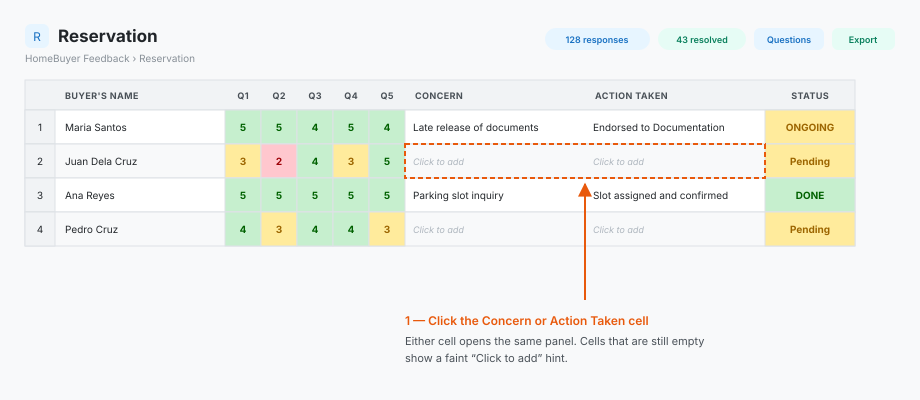
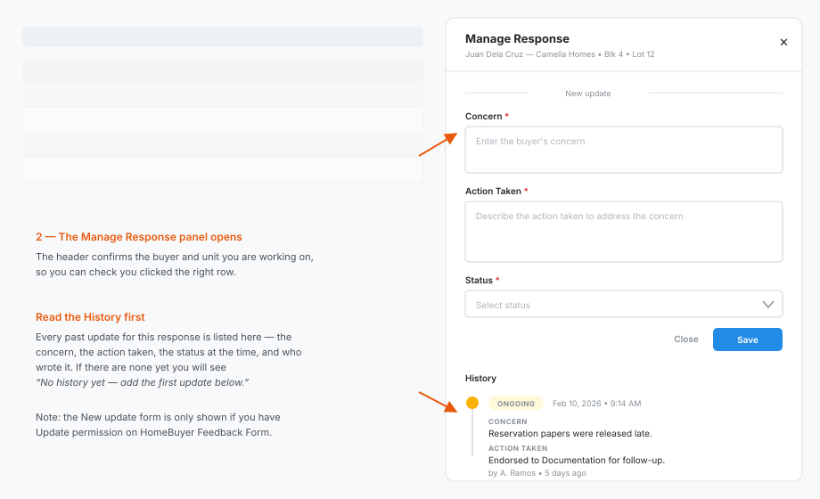
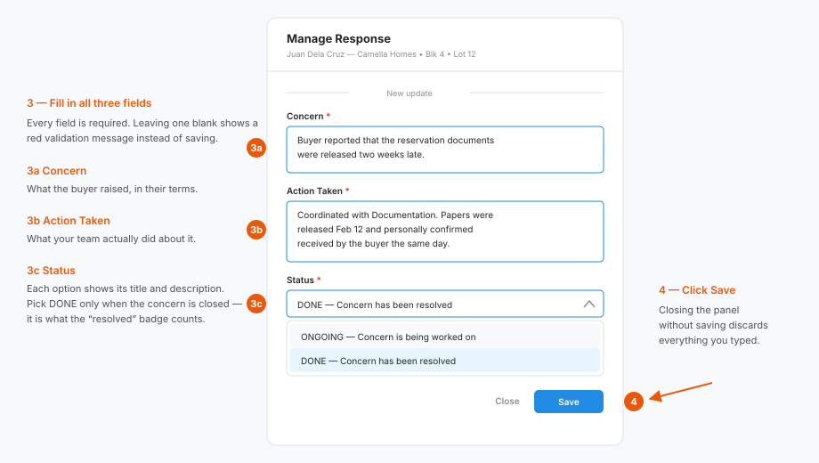
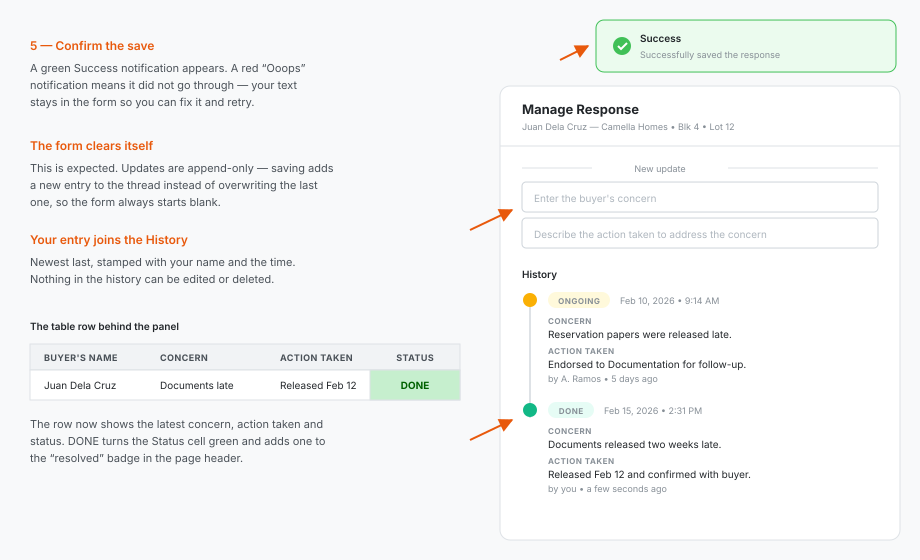

# HomeBuyer Feedback — User Guide

The HomeBuyer Feedback module collects survey responses from buyers at three stages of
their journey and lets your team log what was done about each response.

| Stage | What it measures | Page |
| --- | --- | --- |
| **Reservation** | The experience of reserving a unit | `/feedback/reservation` |
| **Loan Processing** | The experience of getting the loan approved | `/feedback/loan-processing` |
| **Turnover** | The experience of receiving the unit | `/feedback/turnover` |

All three pages work the same way. Read the **Common workflow** section once, then check
the **Per-form differences** section for the columns specific to the form you are on.

---

## 1. Access and permissions

Access is controlled per user under **Setup → Users → Permission**, on the module named
**HomeBuyer Feedback Form**.

| Permission | What it lets you do |
| --- | --- |
| **Read** | Open the overview and the three response pages, filter, and export |
| **Update** | Also add concerns, actions taken, and status updates |

- Without **Read**, opening any feedback page shows a *Forbidden* screen.
- With **Read** but not **Update**, every page is fully visible, but the *New update* form
  inside the Manage Response panel is hidden. You can still read the full history.
- Permissions are loaded at login. If an administrator changes yours, **sign out and back
  in** for the change to take effect.

---

## 2. The overview page

Go to **HomeBuyer Feedback** (`/feedback`). This is the summary screen for the day.

### Response cards

Three cards across the top — Reservation, Loan Processing, Turnover. Each shows:

- the number of **answered surveys**,
- how many surveys were **sent** in total,
- the **response rate** as a percentage and a progress bar.

**Click any card to jump straight to that form's response list.**

### Loan Overall Satisfaction

A bar chart of how many buyers gave each 1–5 star rating for loan processing overall,
with the weighted average shown as a badge (for example `4.21 / 5`). The caption tells you
how many responses the average is based on.

### Hi Plus Mobile App

A donut chart breaking down answers to the Hi Plus mobile app question, with counts and
percentages listed underneath.

### Satisfaction per Question

Three cards, one per form, listing every question with its average satisfaction
percentage and a progress bar. The badge on each card is the average across all of that
form's questions.

> Question text is truncated to one line. **Hover a question** to see the full wording in
> a tooltip.

If a red *Unable to load feedback metrics* banner appears, the data request failed —
refresh the page, and raise it with IT if it persists.

---

## 3. Common workflow

Every response page has the same four areas: the header, the filter bar, the table, and
the Manage Response panel.

### 3.1 Header

| Control | What it does |
| --- | --- |
| **Breadcrumbs** | `HomeBuyer Feedback / <form name>` — click the first crumb to go back to the overview |
| **Response badge** | Total responses received for this form (not affected by filters) |
| **Resolved badge** | How many of those responses have status **DONE** |
| **Questions** | Opens a panel with the full text of every survey question, numbered Q1, Q2, … |
| **Export** | Downloads the currently filtered rows as an Excel file |

> The **Questions** panel is the fastest way to remember what `Q4` actually asked — the
> table only shows the column number.

### 3.2 Filters

Three filters, all applied together (a row must pass all of them to stay visible):

- **Search** — matches against project, phase, block, lot, and buyer's name. Case
  insensitive, matches anywhere in the text. Note that *phase* is searchable even though
  it is not shown as a table column.
- **Status** — pick one of the configured stages (for example `ONGOING`, `DONE`) or
  `Pending` for responses that have no status yet. Click the **x** in the field to clear it.
- **Min. average rate** — click a star to hide any response whose average score is below
  it. Click the same star again to clear the filter.

**How the average is computed:** only the numeric 1–5 score questions count, and blank or
zero answers are ignored. Free-text and multiple-choice answers never affect it. Which
questions are scored differs per form — see [Per-form differences](#4-per-form-differences).

If the filters leave nothing behind, the table shows *No responses found* and the
**Export** button is disabled.

### 3.3 Reading the table

The table is styled like a spreadsheet and scrolls horizontally; the header row stays
pinned while you scroll down.

**Score cells (Q1 onward) are colour-coded:**

| Colour | Score | Meaning |
| --- | --- | --- |
| Green | 4 – 5 | Satisfied |
| Yellow | 3 | Neutral |
| Red | 1 – 2 | Needs attention |

**The Status column** is green when the response is `DONE` and yellow for anything else,
including `Pending` (no status logged yet).

**On the Reservation form only,** the two multiple-choice columns (Q7 and Q8) are also
colour-coded: *Definitely Yes* / *Yes* in green, *Probably Yes* / *Not sure* / *Not yet*
in yellow, and *Probably Not* / *Definitely Not* / *No* in red.

### 3.4 Logging a concern and action taken — step by step

This is the part of the module your team uses every day. It works identically on
Reservation, Loan Processing, and Turnover.

> You need **Update** permission on *HomeBuyer Feedback Form* to do this. With read-only
> access everything below is visible except the form itself.

#### Step 1 — Click the Concern or Action Taken cell

Find the response in the table, then click either its **Concern** or its **Action Taken**
cell. Both open the same panel. Cells with nothing logged yet show a faint *Click to add*
hint.

#### Step 2 — The Manage Response panel opens

The panel slides in from the right. Its header repeats the buyer's name and unit, so you
can confirm you clicked the right row before typing anything.

Below the form is the **History** timeline: every past update for this response, oldest
first, each showing the concern, the action taken, the status at that moment, who wrote
it, and when. Read it before adding your own entry so you do not repeat work someone else
has already done. If nothing has been logged yet you will see *"No history yet — add the
first update below."*

#### Step 3 — Fill in all three fields

All three are required; leaving any of them blank shows a red validation message instead
of saving.

| Field | What to write |
| --- | --- |
| **Concern** | What the buyer raised, in their terms |
| **Action Taken** | What your team actually did about it |
| **Status** | The stage this concern is now at — each option shows its title and description |

Choose **DONE** only when the concern is genuinely closed; it is what the *resolved* badge
in the page header counts.

#### Step 4 — Click Save

**Save** sits at the bottom right of the form. Closing the panel without saving discards
everything you typed.

#### Step 5 — Confirm the result

A green **Success** notification appears, and three things happen at once:

- **The form clears itself.** This is expected — see the note below.
- **Your entry joins the History timeline**, stamped with your name and the time.
- **The table row updates immediately** with your concern, action taken, and status.

If the save fails you get a red *Ooops* notification carrying the server's message. Your
text stays in the form so you can correct it and retry.

> **Updates are append-only.** Saving adds a new entry to the thread rather than
> overwriting the previous one — which is why the form always opens blank. The table shows
> only the most recent concern, action taken, and status; the full record lives in the
> panel's History, and nothing there can be edited or deleted.

Close the panel with **Close**, the **x**, or by clicking outside it.

> **Layout note:** on **Turnover** the History timeline appears *above* the *New update*
> form; on **Reservation** and **Loan Processing** it appears *below* it, as shown in the
> images. The contents and behaviour are identical.

### 3.5 Exporting to Excel

**Export** downloads exactly what the filters currently show — filter first, then export.

| Form | File name |
| --- | --- |
| Reservation | `reservation-feedback-YYYY-MM-DD.xlsx` |
| Loan Processing | `loan-processing-feedback-YYYY-MM-DD.xlsx` |
| Turnover | `turnover-feedback-YYYY-MM-DD.xlsx` |

The workbook keeps the same colour coding as the screen (green/yellow/red on scores and
status, bold grey header row), and adds a **Phase** column that is not shown on screen.
Concern, Action Taken, and Status reflect the latest update only — the full thread
history is not exported.

The button is disabled when the filtered result is empty.

---

## 4. Per-form differences

### Reservation

- **Scored 1–5:** Q1 – Q5. These are what the *Min. average rate* filter uses.
- **Q6** — free text.
- **Q7, Q8** — multiple choice, colour-coded (see above).
- **Q9** — short text.
- Nine questions in total; open **Questions** for the exact wording.

### Loan Processing

- **Scored 1–5:** Q1 – Q6 — one more scored question than the other two forms, so the
  *Min. average rate* filter averages six values here.
- **Q7** — free text.
- This is the form whose overall satisfaction drives the bar chart on the overview page.

### Turnover

- **Scored 1–5:** Q1 – Q5.
- **Q6, Q7, Q8** — free text, shown in full (line breaks preserved) rather than truncated.

---

## 5. Status stages

Status options come from the shared **Action Taken Stage** list, so all three forms use
the same set. The two you will normally see are:

| Status | Meaning |
| --- | --- |
| **ONGOING** | The concern is being worked on |
| **DONE** | The concern is resolved — counts toward the *resolved* badge |
| **Pending** | Not a real stage — this is what the table shows when no update has been logged yet |

Each option in the Status dropdown shows its description alongside the title, so pick
based on that if your organisation has configured additional stages.

---

## 6. Troubleshooting

| What you see | What to do |
| --- | --- |
| *Forbidden* screen | You lack **Read** on *HomeBuyer Feedback Form*. Ask an administrator, then sign out and in. |
| No *New update* form in the panel | You have **Read** but not **Update** on the module. |
| *Unable to load … responses* banner | The data request failed. Refresh; if it persists, report it. |
| *Unable to load questions* / *Unable to load history* | Same as above, scoped to that panel. Close and reopen it to retry. |
| *No responses found* | The filters are too narrow. Clear the search, the status, and reset the star rating. |
| **Export** greyed out | There are no rows to export — widen your filters. |
| Response counts look wrong | The response and resolved badges count **all** responses, not the filtered ones. |
| Status still shows *Pending* after saving | Confirm the save notification was green; if it was red, the update did not go through. |

---

## 7. Quick reference

| Task | Where |
| --- | --- |
| See overall response rates | Overview (`/feedback`) |
| Jump to a form's responses | Click its card on the overview |
| Read the survey questions | **Questions** button in the page header |
| Find one buyer | **Search** box — name, project, phase, block, or lot |
| Show only unresolved items | **Status** filter → `ONGOING` or `Pending` |
| Show only unhappy buyers | **Min. average rate** → 1 or 2 stars, then sort through the red cells |
| Log a concern or action | Click the row's **Concern** or **Action Taken** cell |
| See who handled a response | **History** timeline in the Manage Response panel |
| Hand data to someone else | Filter, then **Export** |
